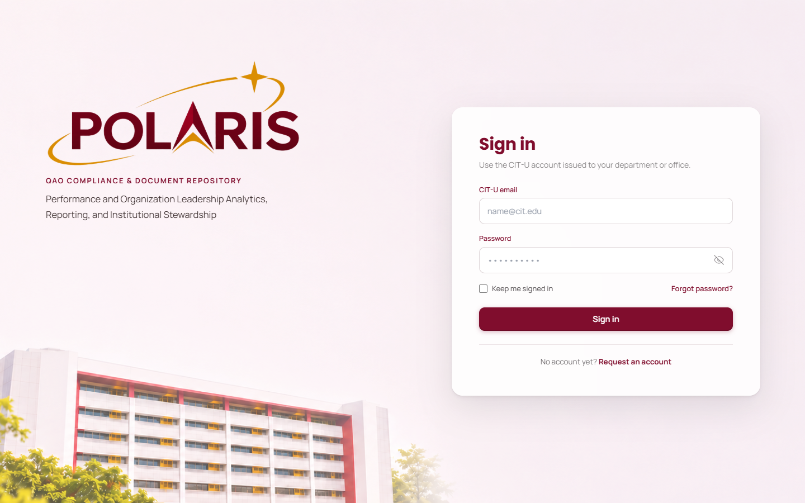
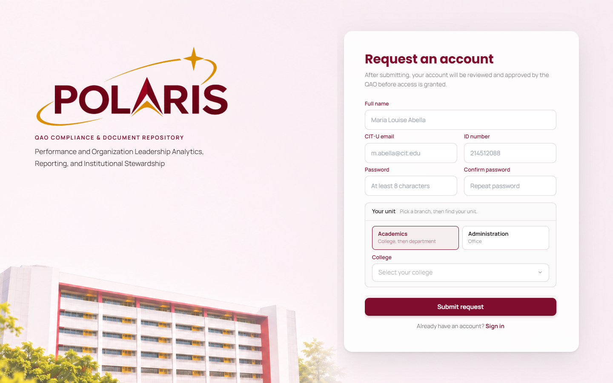
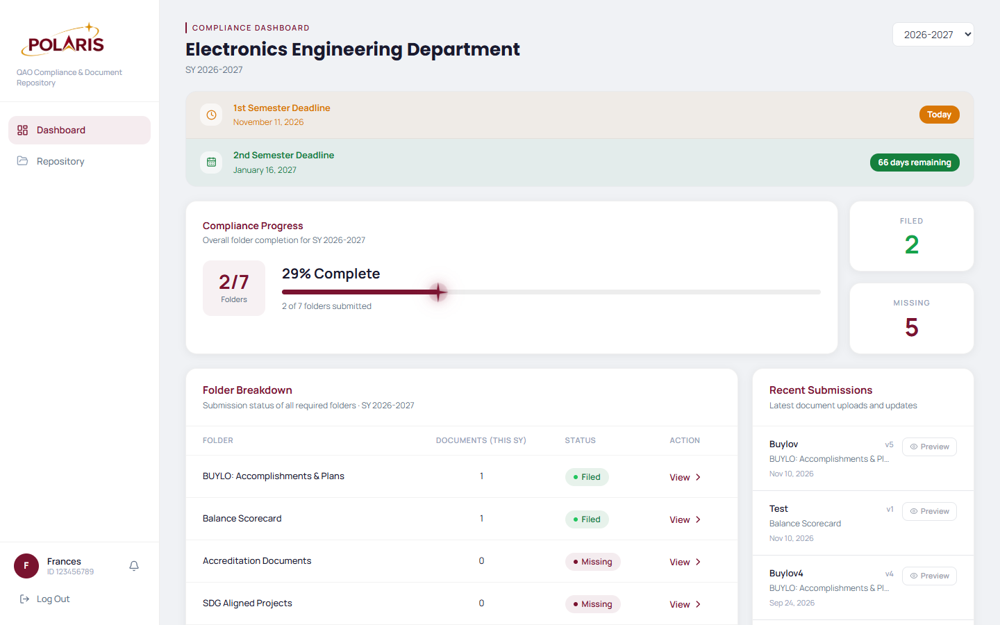
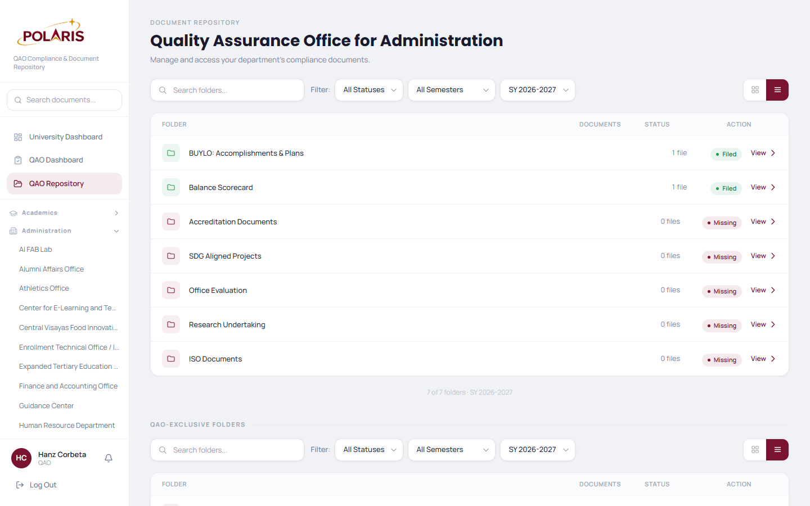
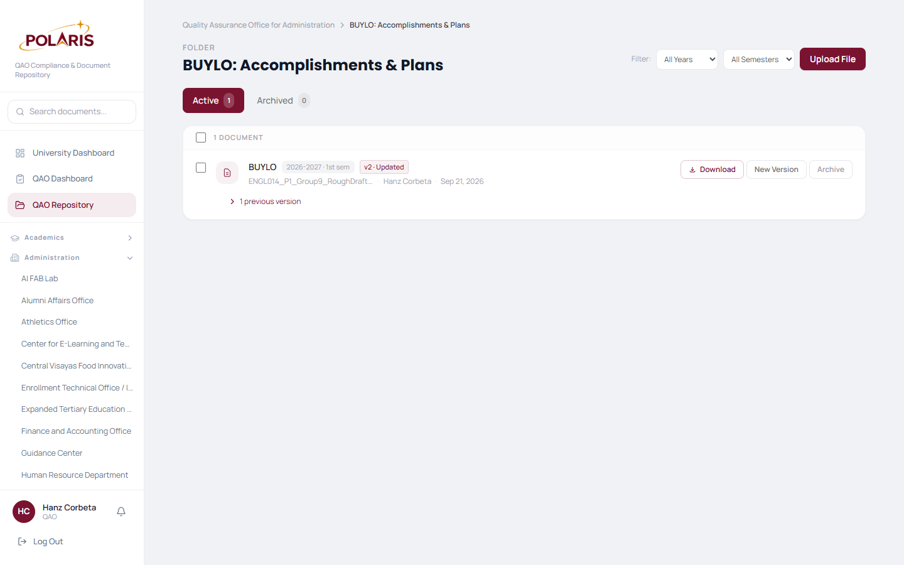
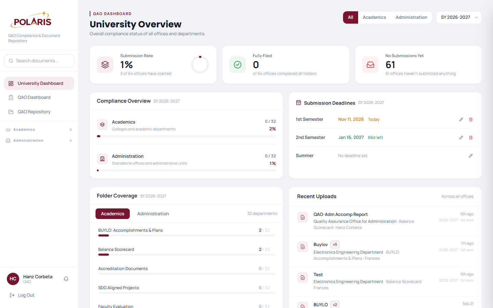
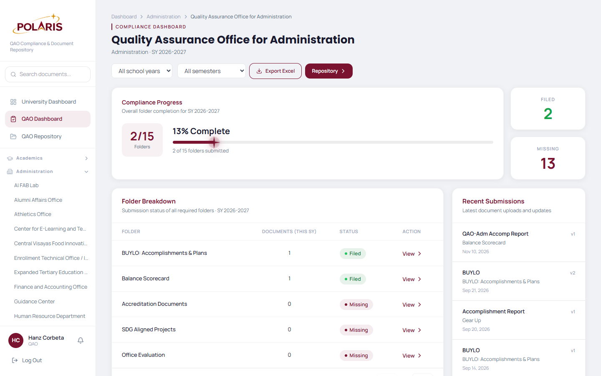
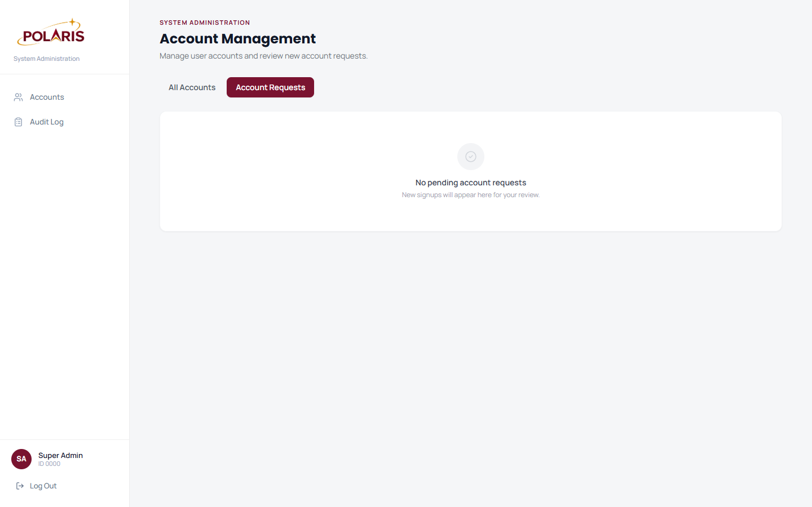
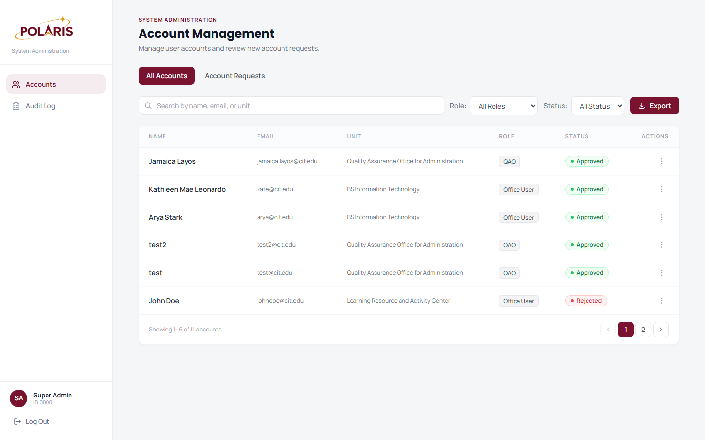
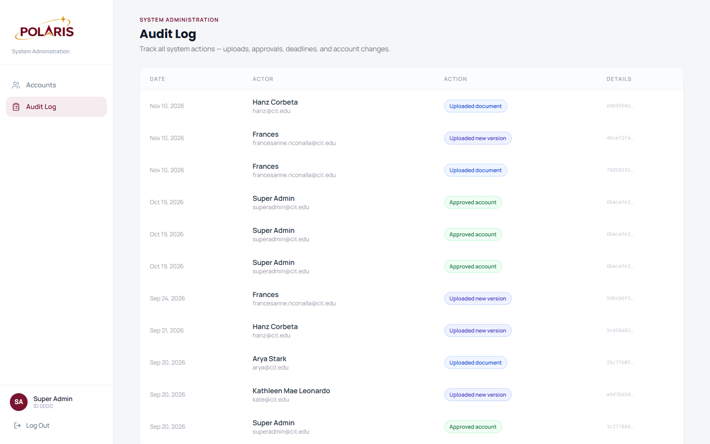

# POLARIS

**P**erformance and **O**rganization **L**eadership **A**nalytics, **R**eporting, and **I**nstitutional **S**tewardship

A document repository and compliance tracking portal for CIT-U's Quality Assurance Office. Every college/department and administration office submits its required documents here; QAO can monitor submission status across all 40+ offices, offices can only see their own.

---

## Screenshots

### Login & Signup
| Login | Sign Up |
|-------|---------|
|  |  |

### Office User
| Compliance Dashboard | Document Repository (unit) | Document Repository (folder) |
|----------------------|---------------------------|------------------------------|
|  |  |  |

### QAO
| University Overview | Office Compliance Dashboard |
|---------------------|-----------------------------|
|  |  |

### System Administration
| Account Requests | All Accounts | Audit Log |
|------------------|--------------|-----------|
|  |  |  |

---

## Tech stack

- **Next.js 14** (App Router, TypeScript) — deployed on Vercel
- **Supabase** — Postgres database, Auth, and Storage
- **Tailwind CSS** — CIT-U maroon/gold palette, Manrope + Poppins fonts

---

## Roles

| Role | What they can do |
|---|---|
| **office_user** | Upload, version, and archive documents for their own unit. See their own submission status dashboard. |
| **qao** | Read-only access to all units' repositories, dashboards, and version histories. Archive/restore any document. Cannot upload on behalf of offices. |
| **system_admin** | Manage user accounts and approvals only. No access to document contents. |

---

## How it works

### Signup → approval flow
Office staff register at `/signup` and are immediately locked to a waiting screen (`/pending`). Their account sits at `status = 'pending'` until a system admin approves them at `/admin/approvals`. Once approved they can access their dashboard and repository. QAO and system admin accounts are created directly — there is no public signup path for those roles.

### Compliance tracking
Every office has the same set of required folders: BUYLO: Accomplishments & Plans, Balance Scorecard, Accreditation Documents, SDG Aligned Projects, Office/Faculty Evaluation, Research Undertaking, and ISO Documents. The system tracks whether each folder has at least one document filed for the current school year and automatically produces a **Filed / Missing** status per folder — no manual input needed. QAO sees this rolled up across all 40+ offices in the university overview dashboard.

### Document versioning
Uploading a "new version" inserts a new row with `previous_version_id` pointing at the old one and flips `is_latest` to `false` on the previous row. The full version chain is always walkable, and both the office user and QAO can download any historical version.

### Soft deletes only
`documents.archived` is the only removal path. Nothing is ever deleted from the database or from Storage. Archived documents are hidden from the default view but visible under the Archived tab and can be restored at any time.

### Permission model
All data access is server-side via the Supabase service role key — it never reaches the browser. Every data function checks the caller's role and `unit_id` before returning anything.

- **office_user** — read/write their own unit only
- **qao** — read any unit, archive/restore any document, cannot upload on behalf of offices
- **system_admin** — manage accounts only, no access to document contents

### Audit log
Every significant action (upload, new version, archive, restore, account approval/rejection) is written to an immutable `audit_log` table with actor, action type, timestamp, and a reference to the affected record. The log is visible to system admins and cannot be edited or deleted.
